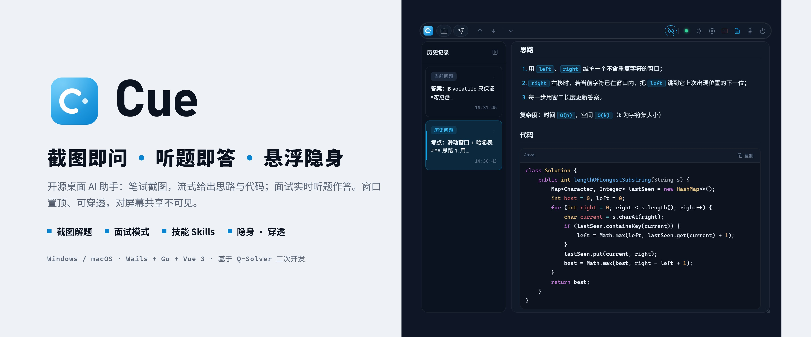

<div align="center">
  

  <h1>Cue</h1>
  <p><strong>截图即问 · 听题即答 · 悬浮隐身</strong></p>
  <p>开源的桌面 AI 助手：笔试截图，流式给出思路与代码；面试实时听题作答。<br>窗口置顶、可穿透、不抢焦点，对屏幕共享不可见。用你自己的 API Key 就能开始。</p>

  <p>
    <a href="https://github.com/Marchen-orz/Cue/stargazers"></a>
    <a href="https://github.com/Marchen-orz/Cue/releases"></a>
    
    
    
  </p>

  <p>
    
    
    
  </p>

  <p>
    <a href="README_EN.md">English</a>
  </p>
</div>

> Cue 基于 [Q-Solver](https://github.com/jym66/Q-solver) 二次开发。

---

## 演示

<div align="center">
  <a href="assets/cue-promo.mp4"></a>
  <p>▶ <a href="assets/cue-promo.mp4">完整演示视频（约 3 分钟，含配乐）</a></p>
</div>

---

## 这是什么

Cue 是一个常驻桌面的 AI 助手，平时只是一条悬浮工具条。

- **看到题**——按 `F8` 截图、`Ctrl+J` 发送，思考过程与答案流式输出，不用切窗口、不用复制粘贴。
- **听到题**——按 `F5` 开启面试模式，它实时转写对方的声音，判定出问题后自动作答，连续追问也接得住。
- **不打扰**——窗口始终置顶但不抢焦点，可以调透明、让鼠标点穿，并且对屏幕共享、录屏、截图不可见。

模型用你自己的：任何 OpenAI 兼容接口都可以接入。

---

## 功能

### 截图解题


- 框选区域、整屏或指定显示器截图，最多 3 张合并成一次提问
- 思考过程与答案逐字流式输出，Markdown、公式、代码高亮都有
- 每次解题都留在左侧历史记录里，随时回看
- `Alt + PgUp / PgDn` 免鼠标翻页，答案可一键复制或导出为图片
- 截图的压缩质量、锐化、灰度、是否原图上传均可调，按题型与 token 成本取舍

### 面试模式


- 监听系统音频（会议软件里面试官的声音）或麦克风，实时转写成字幕
- **自动模式**：识别到疑问句且对方停顿后自动作答（停顿阈值可调，默认 0.8 秒）；**手动模式**：按 `F3` 立即回答
- 保留多轮上下文（最近 8 轮），追问不用重复背景
- 自动结合你导入的简历作答
- 可单独指定一个更快的「面试模型」，和笔试用的主模型分开
- 语音识别使用阿里云百炼的 Paraformer 实时模型，断线自动重连

### 技能 Skills

<div align="center">
  
</div>

- 导入 Claude 格式的技能：含 `SKILL.md` 的文件夹、`.zip`，或单个 `.md`
- 答题前先按题目自动路由，只把相关技能（每题最多 2 个）注入提示词
- 截图解题与面试模式都生效；每个技能可单独开关、预览、删除

### 隐身、穿透、透明


- **隐身**（`F9`）：窗口对屏幕共享、录屏、截图不可见，你自己照常能看到
- **鼠标穿透**（`F10`）：鼠标直接点到下层窗口，Cue 只负责显示
- **透明度**（`Alt + Shift + ↑ / ↓`）：每次 5%，看得见被挡住的内容
- **悬停触发**：穿透模式下，光标在工具条按钮上停留片刻即触发，全程不产生点击
- **快捷键屏蔽**（`F6`，仅 Windows）：Cue 的快捷键在按下时即被拦截，不会泄露给其他程序；正常打字不受影响
- **不抢焦点**：答案刷新时，你正在输入的窗口不会失去焦点

> [!NOTE]
> 隐身依赖操作系统提供的防采集接口（Windows 10 2004 及以上 / macOS），不同系统版本和采集软件下表现可能不同，重要场合请先自测。

### 悬浮工具条

<div align="center">
  
</div>

`F7` 把完整面板折叠成一条工具条，需要时再展开。

<div align="center">
  
</div>

### 还有这些

| | |
|:---|:---|
| **存储复盘**（`F4`） | 每道题的截图与解答、面试模式的每轮问答，自动存成 Markdown（`文档/Cue/复盘`，目录可改），考后逐题回看 |
| **简历解析** | 导入 PDF 简历，用你自己的模型整理为 Markdown，回答自动贴合你的项目与经历 |
| **题型自动识别** | 批改、编程、选择题、英语翻译、数理计算、简答案例等 7 类答法，模型看过截图后自动选用，无需手动切换 |
| **任意兼容接口** | 预设 OpenAI、Google、Anthropic、DeepSeek、阿里云百炼、Moonshot、OpenRouter，也可自定义 Base URL |
| **浅色 / 深色主题** | 两套完整配色 |

<table>
  <tr>
    <td width="50%"></td>
    <td width="50%"></td>
  </tr>
  <tr>
    <td align="center">模型与思考强度</td>
    <td align="center">截图模式与区域</td>
  </tr>
  <tr>
    <td></td>
    <td></td>
  </tr>
  <tr>
    <td align="center">面试模式设置</td>
    <td align="center">快捷键录制</td>
  </tr>
</table>

<div align="center">
  
  <p>浅色主题</p>
</div>

---

## 快速开始

### 方式一：直接下载

前往 [Releases](https://github.com/Marchen-orz/Cue/releases) 下载对应系统的版本：

| 系统 | 文件 |
|:---|:---|
| Windows x64 | `cue-windows-amd64.exe` |
| macOS Apple Silicon | `cue-macos-arm64.zip` |
| macOS Intel | `cue-macos-amd64.zip` |

> [!NOTE]
> macOS 首次运行如果提示无法打开，把应用拖进「应用程序」并改名为 `Cue.app` 后执行：
> ```bash
> xattr -cr /Applications/Cue.app
> chmod +x /Applications/Cue.app/Contents/MacOS/Cue
> ```

### 方式二：源码运行

环境要求：Go 1.25+、Node.js 22+、Wails CLI v2。

```bash
go install github.com/wailsapp/wails/v2/cmd/wails@latest

git clone https://github.com/Marchen-orz/Cue.git
cd Cue

wails dev
```

构建发布版：

```bash
wails build -ldflags "-s -w" -tags prod
```

---

## 配置

第一次使用按这个顺序：

1. 点工具条上的齿轮打开设置
2. **API** 页：选择模型提供商，填写 `API Key`；自定义兼容接口再填 `Base URL`
3. **模型** 页：刷新模型列表，选一个模型（截图解题需要支持图片输入），按需调整思考强度；题型由模型自动识别，无需再选场景
4. **截图** 页：选择框选区域或全屏，按需调整压缩参数
5. 回到主界面，`F8` 截图、`Ctrl+J` 发送

要使用面试模式，再多做一步：

6. **面试** 页：填写阿里云百炼的 `API Key`（用于语音识别，和上面的模型 Key 相互独立），选择音频来源与触发方式；可另选一个响应更快的面试模型

可选：在 **简历** 页导入 PDF 简历，在 **技能** 页导入技能包。

---

## 快捷键

| 动作 | Windows | macOS |
|:---|:---:|:---:|
| 截图 | `F8` | `⌘ 1` |
| 发送解题 | `Ctrl + J` | `⌘ J` |
| 删除截图 | `Ctrl + D` | `⌘ D` |
| 隐身开关 | `F9` | `⌘ 2` |
| 鼠标穿透 | `F10` | `⌘ 3` |
| 折叠 / 展开面板 | `F7` | `⌘ 4` |
| 快捷键屏蔽 | `F6` | — |
| 存储复盘 | `F4` | — |
| 面试模式 | `F5` | `⌘ 7` |
| 面试立即回答 | `F3` | `⌘ 8` |
| 移动窗口 | `Alt + 方向键` | `⌘ ⌥ 方向键` |
| 滚动内容 | `Alt + PgUp / PgDn` | `⌘ ⌥ ⇧ ↑ / ↓` |
| 调节透明度 | `Alt + Shift + ↑ / ↓` | — |

> Windows 上的快捷键都可以在「设置 → 常规」里重新录制；macOS 目前使用固定快捷键，标 — 的功能请用工具条按钮或设置面板操作。

---

## 平台支持

| 能力 | Windows | macOS |
|:---|:---:|:---:|
| 截图解题、技能、题型自动识别、简历解析、存储复盘 | ✅ | ✅ |
| 隐身、鼠标穿透、透明度 | ✅ | ✅ |
| 面试模式 | ✅ | 暂不支持（音频采集尚未实现） |
| 快捷键屏蔽 | ✅ | — |
| 自定义快捷键 | ✅ | — |

---

## 技术栈

- Core：Go
- Desktop Binding：Wails v2
- Frontend：Vue 3 + Pinia
- LLM：OpenAI 兼容接口
- ASR：阿里云百炼 Paraformer 实时语音识别

---

## 免责声明

本项目仅供个人学习、练习与技术研究使用。请遵守你所参加的考试、面试以及所用平台的规则，因使用本软件产生的一切后果由使用者自行承担。

## License

本项目以 **CC BY-NC 4.0** 许可公开源码，仅限非商业使用。

---

<div align="center">
  <p>如果 Cue 对你有帮助，欢迎点一个 Star。</p>
</div>
