<div align="center">
  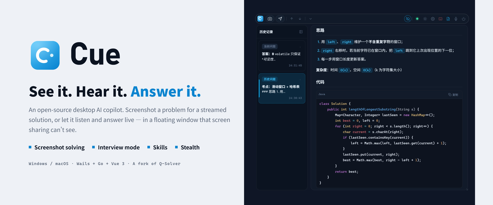

  <h1>Cue</h1>
  <p><strong>See it. Hear it. Answer it.</strong></p>
  <p>An open-source desktop AI assistant: screenshot a problem and get reasoning and code streamed back; in interviews it listens and answers in real time.<br>Always on top, click-through, never steals focus, and invisible to screen sharing. Bring your own API key.</p>

  <p>
    <a href="https://github.com/Marchen-orz/Cue/stargazers"></a>
    <a href="https://github.com/Marchen-orz/Cue/releases"></a>
    
    
    
  </p>

  <p>
    
    
    
  </p>

  <p>
    <a href="README.md">简体中文</a>
  </p>
</div>

> Cue is a fork of [Q-Solver](https://github.com/jym66/Q-solver).

---

## Demo

<div align="center">
  <a href="assets/cue-promo.mp4"></a>
  <p>▶ <a href="assets/cue-promo.mp4">Full demo video (about 3 min, with music)</a></p>
</div>

> The interface is currently in Chinese.

---

## What is it

Cue is an AI assistant that lives on your desktop as a small floating toolbar.

- **See a question** — press `F8` to capture and `Ctrl+J` to send. Reasoning and the answer stream in, with no window switching and no copy-paste.
- **Hear a question** — press `F5` to start interview mode. Cue transcribes the other side in real time, detects when a question has been asked, and answers it. Follow-ups keep their context.
- **Stay out of the way** — the window stays on top without taking focus, can be made transparent or click-through, and is hidden from screen sharing, recordings and screenshots.

You bring the model: any OpenAI-compatible endpoint works.

---

## Features

### Screenshot solving

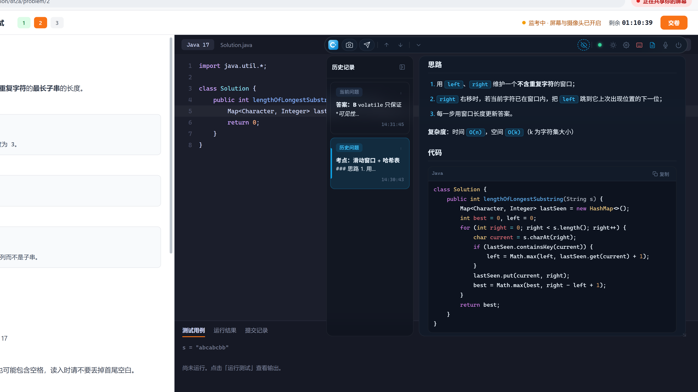

- Capture a region, the full screen, or a specific monitor; up to 3 screenshots are combined into one question
- Reasoning and answers stream in with Markdown, math and syntax highlighting
- Every solve stays in the history sidebar on the left, so you can go back to it at any time
- Scroll with `Alt + PgUp / PgDn` without touching the mouse; copy an answer or export it as an image in one click
- Compression quality, sharpening, grayscale and original-size upload are all adjustable, so you can trade accuracy against token cost

### Interview mode

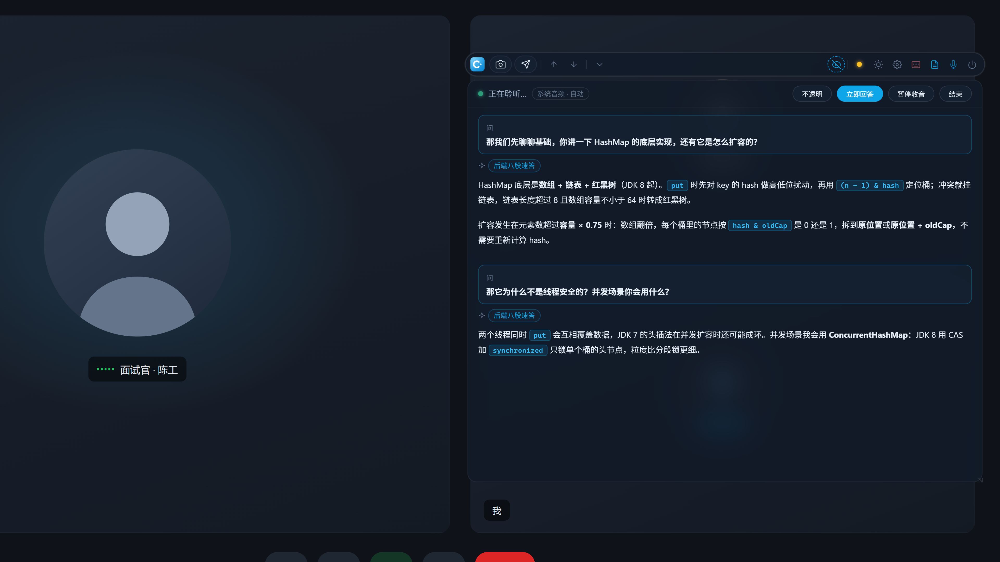

- Listens to system audio (the interviewer's voice in your meeting app) or the microphone and shows a live transcript
- **Auto mode** answers once a question is detected and the speaker pauses (threshold adjustable, 0.8 s by default); **manual mode** answers when you press `F3`
- Keeps the last 8 rounds as context, so follow-ups do not need the background repeated
- Uses your imported resume when answering
- Can use a separate, faster "interview model" alongside the main model
- Speech recognition runs on Alibaba Cloud Bailian's Paraformer real-time model, with automatic reconnection

### Skills

<div align="center">
  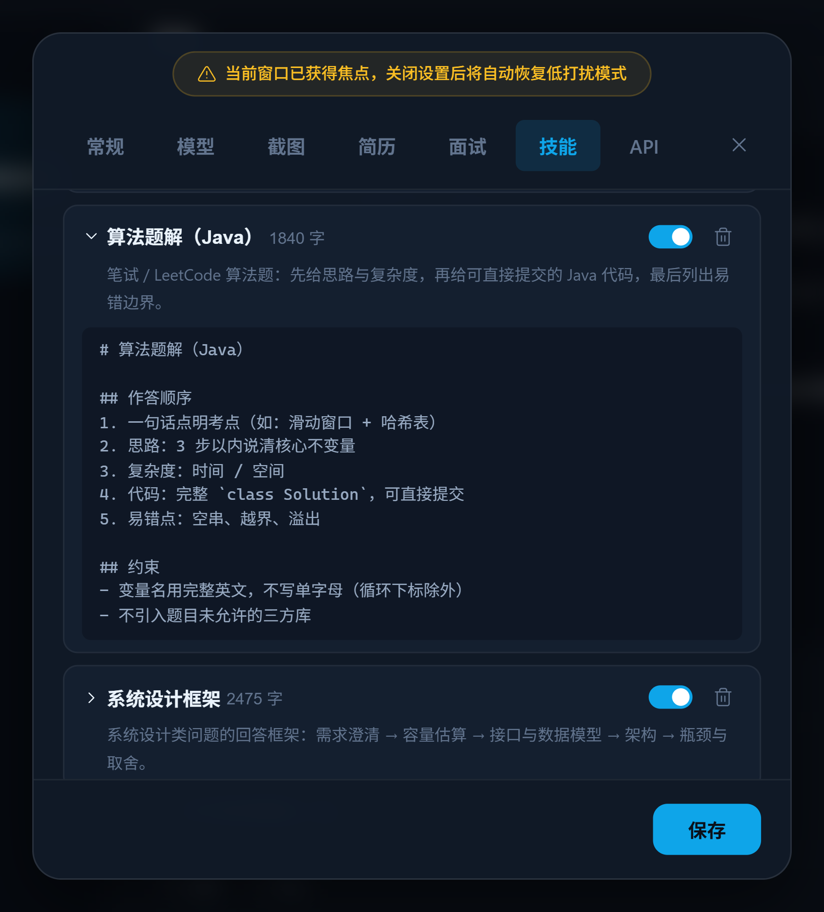
</div>

- Import Claude-format skills: a folder containing `SKILL.md`, a `.zip`, or a single `.md` file
- Each question is routed automatically, and only the relevant skills (at most 2 per question) are added to the prompt
- Works in both screenshot solving and interview mode; each skill can be toggled, previewed or deleted

### Stealth, click-through, transparency

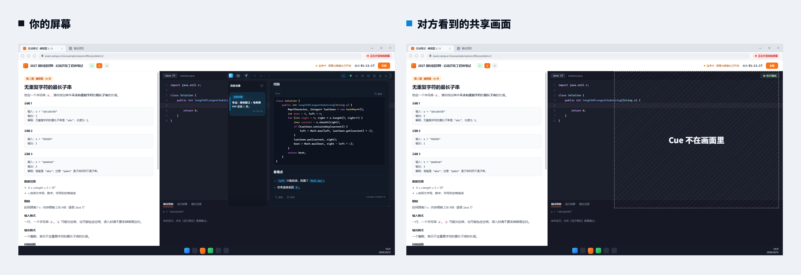

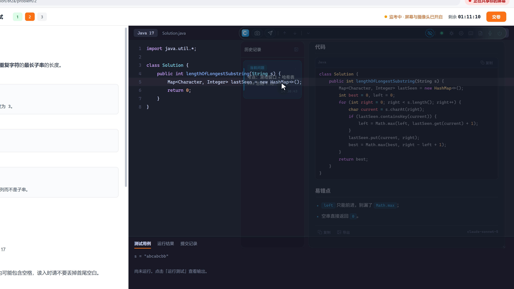

- **Stealth** (`F9`): the window is hidden from screen sharing, recordings and screenshots, while you still see it
- **Click-through** (`F10`): mouse input passes to the window underneath; Cue only displays
- **Opacity** (`Alt + Shift + ↑ / ↓`): 5% per step, so you can see what is behind the window
- **Hover trigger**: in click-through mode, resting the cursor on a toolbar button for a moment activates it, without a single click
- **Shortcut shield** (`F6`, Windows only): Cue's shortcuts are intercepted on key-down and never reach other applications; normal typing is unaffected
- **No focus stealing**: the window you are typing in keeps focus while answers update

> [!NOTE]
> Stealth relies on capture-exclusion APIs provided by the operating system (Windows 10 version 2004 or later / macOS). Behaviour can vary with the OS version and the capture software, so test it yourself before relying on it.

### Floating toolbar

<div align="center">
  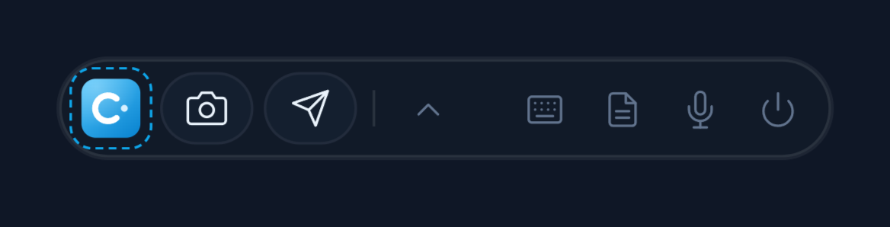
</div>

`F7` collapses the full panel into a single toolbar and expands it again.

<div align="center">
  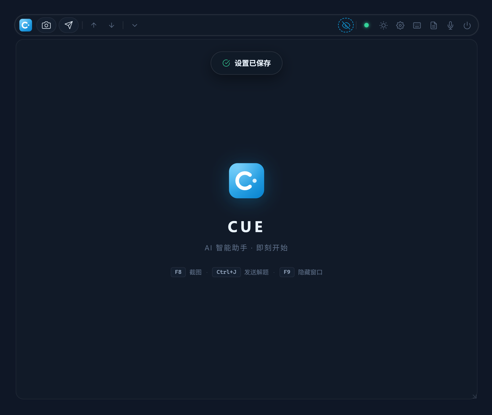
</div>

### And more

| | |
|:---|:---|
| **Review archive** (`F4`) | Saves each question's screenshots and answer, and every interview-mode Q&A round, as Markdown (`Documents/Cue/复盘` by default, configurable) for later review |
| **Resume parsing** | Import a PDF resume; your own model converts it to Markdown, and answers draw on your projects and experience |
| **Automatic question-type routing** | 7 answering styles (grading, coding, multiple choice, English/translation, math & science, short-answer/case analysis, other); the model picks the right one after seeing the screenshot, no manual switching |
| **Any compatible endpoint** | Presets for OpenAI, Google, Anthropic, DeepSeek, Alibaba Cloud Bailian, Moonshot and OpenRouter, or a custom Base URL |
| **Light / dark themes** | Two complete colour schemes |

<table>
  <tr>
    <td width="50%">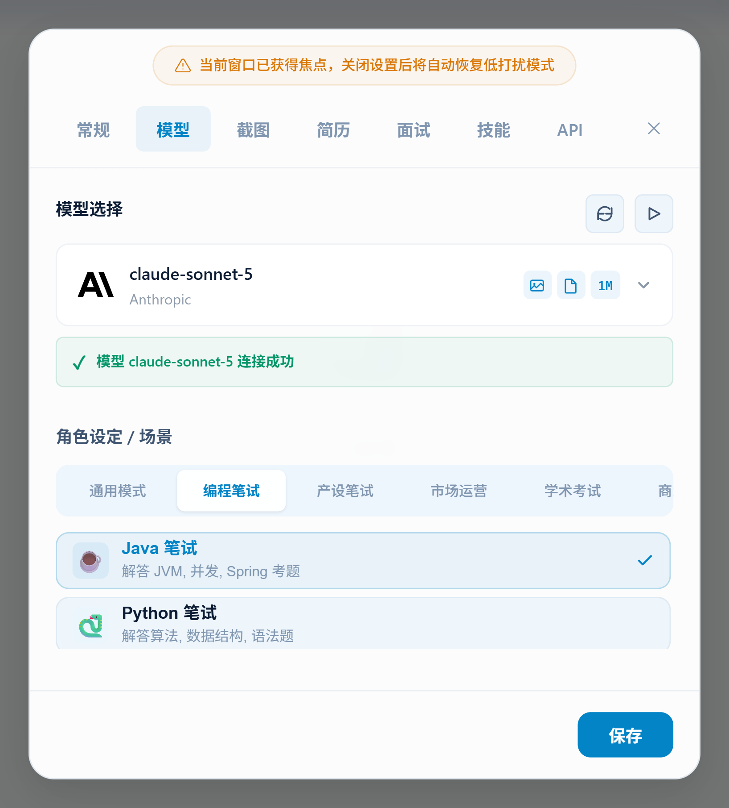</td>
    <td width="50%">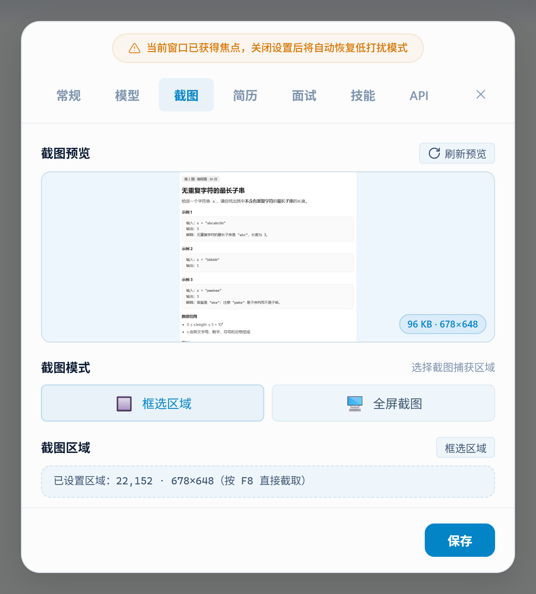</td>
  </tr>
  <tr>
    <td align="center">Model and reasoning effort</td>
    <td align="center">Capture mode and region</td>
  </tr>
  <tr>
    <td>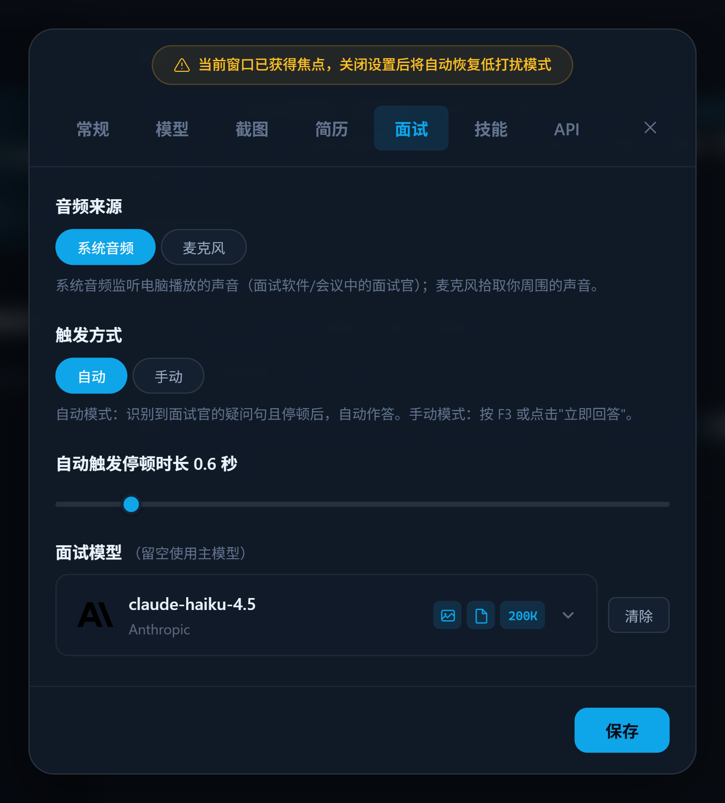</td>
    <td>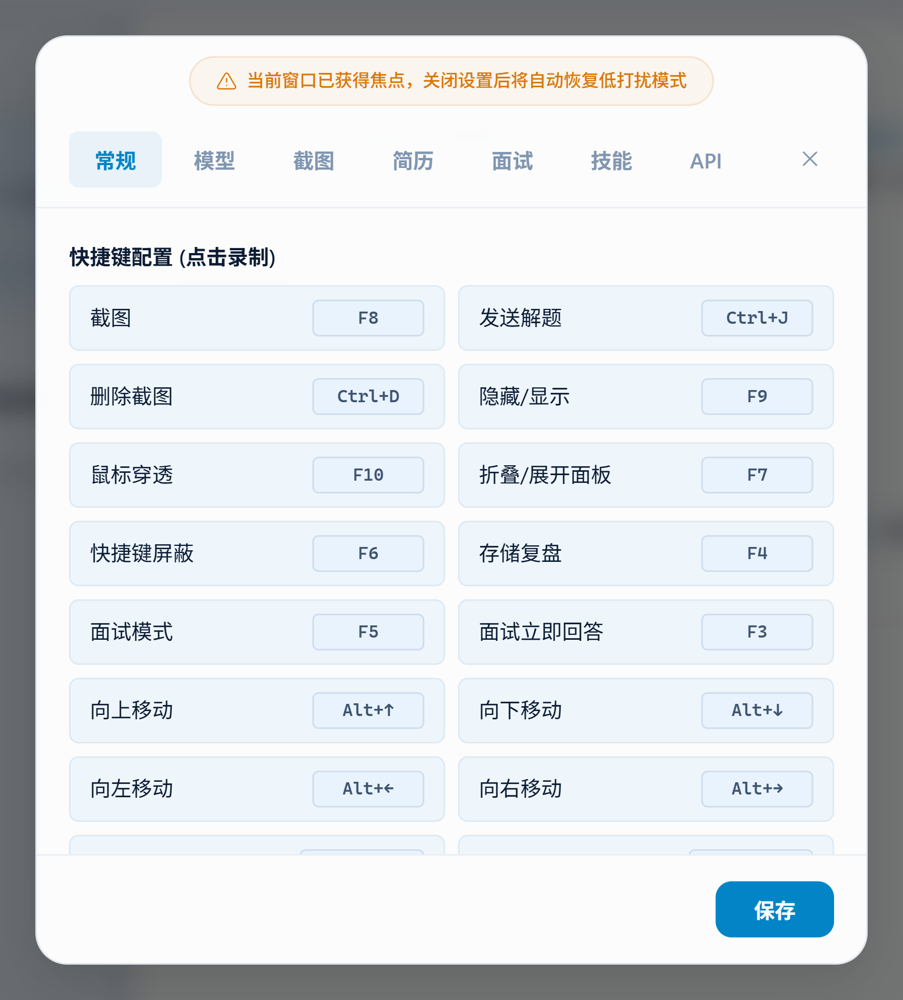</td>
  </tr>
  <tr>
    <td align="center">Interview mode settings</td>
    <td align="center">Shortcut recording</td>
  </tr>
</table>

<div align="center">
  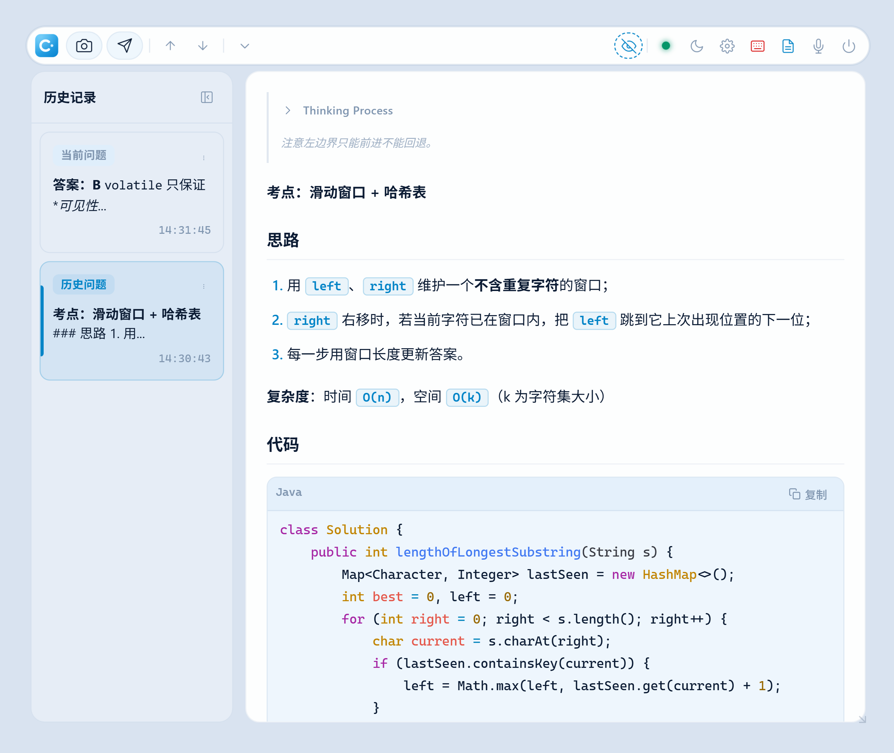
  <p>Light theme</p>
</div>

---

## Quick start

### Option 1: download

Get the build for your system from [Releases](https://github.com/Marchen-orz/Cue/releases):

| System | File |
|:---|:---|
| Windows x64 | `cue-windows-amd64.exe` |
| macOS Apple Silicon | `cue-macos-arm64.zip` |
| macOS Intel | `cue-macos-amd64.zip` |

> [!NOTE]
> If macOS refuses to open the app on first launch, move it to Applications, name it `Cue.app`, then run:
> ```bash
> xattr -cr /Applications/Cue.app
> chmod +x /Applications/Cue.app/Contents/MacOS/Cue
> ```

### Option 2: run from source

Requirements: Go 1.25+, Node.js 22+, Wails CLI v2.

```bash
go install github.com/wailsapp/wails/v2/cmd/wails@latest

git clone https://github.com/Marchen-orz/Cue.git
cd Cue

wails dev
```

Build a release binary:

```bash
wails build -ldflags "-s -w" -tags prod
```

---

## Configuration

On first use, in this order:

1. Click the gear on the toolbar to open settings
2. **API** tab: choose a provider and enter your `API Key`; for a custom compatible endpoint, also enter the `Base URL`
3. **模型** (Model) tab: refresh the model list, pick a model (screenshot solving needs image input support), then adjust the reasoning effort if needed; the question type is detected automatically, no scene to pick
4. **截图** (Screenshot) tab: choose region or full-screen capture and adjust compression if needed
5. Back in the main view, press `F8` to capture and `Ctrl+J` to send

For interview mode, one more step:

6. **面试** (Interview) tab: enter an Alibaba Cloud Bailian `API Key` (used for speech recognition, separate from the model key above), then choose the audio source and trigger mode; optionally pick a faster interview model

Optional: import a PDF resume in the **简历** (Resume) tab and skill packs in the **技能** (Skills) tab.

---

## Shortcuts

| Action | Windows | macOS |
|:---|:---:|:---:|
| Screenshot | `F8` | `⌘ 1` |
| Send / solve | `Ctrl + J` | `⌘ J` |
| Delete screenshot | `Ctrl + D` | `⌘ D` |
| Toggle stealth | `F9` | `⌘ 2` |
| Click-through | `F10` | `⌘ 3` |
| Collapse / expand panel | `F7` | `⌘ 4` |
| Shortcut shield | `F6` | — |
| Review archive | `F4` | — |
| Interview mode | `F5` | `⌘ 7` |
| Interview: answer now | `F3` | `⌘ 8` |
| Move window | `Alt + arrow keys` | `⌘ ⌥ arrow keys` |
| Scroll content | `Alt + PgUp / PgDn` | `⌘ ⌥ ⇧ ↑ / ↓` |
| Adjust opacity | `Alt + Shift + ↑ / ↓` | — |

> On Windows every shortcut can be re-recorded under Settings → 常规 (General). macOS currently uses fixed shortcuts; for actions marked —, use the toolbar buttons or the settings panel.

---

## Platform support

| Capability | Windows | macOS |
|:---|:---:|:---:|
| Screenshot solving, skills, automatic question-type routing, resume parsing, review archive | ✅ | ✅ |
| Stealth, click-through, opacity | ✅ | ✅ |
| Interview mode | ✅ | Not yet (audio capture is not implemented) |
| Shortcut shield | ✅ | — |
| Custom shortcuts | ✅ | — |

---

## Tech stack

- Core: Go
- Desktop binding: Wails v2
- Frontend: Vue 3 + Pinia
- LLM: OpenAI-compatible API
- ASR: Alibaba Cloud Bailian Paraformer real-time speech recognition

---

## Disclaimer

This project is for personal learning, practice and technical research only. Follow the rules of any exam, interview or platform you take part in; you are solely responsible for how you use this software.

## License

The source is released under **CC BY-NC 4.0**, for non-commercial use only.

---

<div align="center">
  <p>If Cue helps you, a Star is appreciated.</p>
</div>
